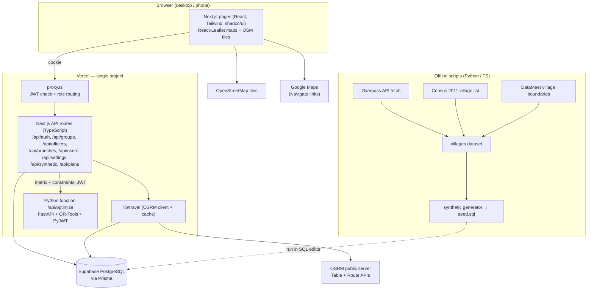
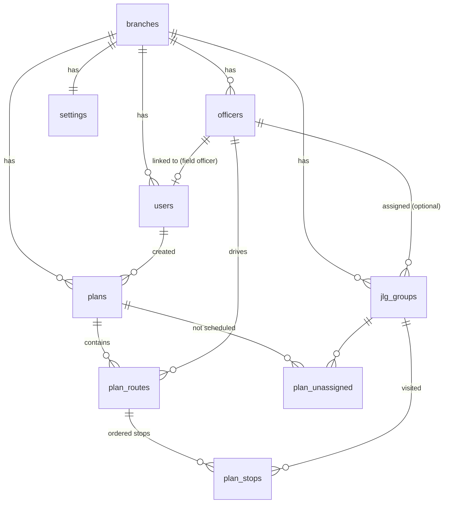

# MFI Route Optimizer — Architecture

How the system is built: components, data model, APIs, the optimizer, security and deployment. For user journeys see [flow.md](flow.md); for the handoff overview see [handoff.md](handoff.md).

---

## 1. Principles (agreed decisions)

| Decision | Choice |
|---|---|
| Project shape | **One Next.js project, one Vercel deployment.** Frontend + TypeScript API routes, plus **one Python serverless function** for optimization. Same origin → no CORS. |
| Optimizer | **Google OR-Tools** (Python) — VRPTW with time windows, service times, breaks, optional visits with priority penalties, multiple officers. |
| Road travel times | **OSRM public server** (`router.project-osrm.org`), car profile × **two-wheeler speed factor**; every pair cached in PostgreSQL. OSRM URL is a setting, so a self-hosted OSRM is a drop-in later. |
| Database | **Supabase PostgreSQL only** (no Supabase Auth, no Supabase JS client). Accessed through **Prisma**. |
| Migrations | Written as **Prisma migration SQL files** in `prisma/migrations/`. The mentor runs them in the **Supabase SQL editor**; the student can recreate the same database with `prisma migrate deploy`. |
| Auth | **Own JWT auth**: bcrypt password hashes, `jose`-signed JWT in an httpOnly cookie, Next.js proxy (`proxy.ts`, Next 16's name for middleware) + role checks, PyJWT check in the Python function. |
| Roles | **Manager** (everything) and **Field Officer** (My Day only). |
| Data | **Synthetic JLG data** on real Baramati-taluka villages (real JLG data is not public) + manual entry forms with a map picker. |
| UI | Reproduces the reference design in `D:\CreatED-MFI\frontend` (v0 + completed phases): Next.js, Tailwind, shadcn/ui, lucide, React-Leaflet. |
| Hosting | Public demo on free tiers: **Vercel Hobby + Supabase Free**. Non-commercial student project. |

---

## 2. System diagram



**Why the Python function does not touch the database:** the TypeScript route prepares everything (data + travel matrix) and stores the result. The Python function is a pure function *input → solution*, which keeps it small, fast to cold-start, easy to unit-test, and free of database credentials.

---

## 3. Tech stack

| Layer | Technology |
|---|---|
| Languages | TypeScript, Python 3.11 (3.12 on Vercel), SQL |
| Frontend | Next.js (App Router), React, Tailwind CSS v4, shadcn/ui, lucide-react, React-Leaflet + Leaflet |
| Backend (TS) | Next.js route handlers, Prisma Client, `jose` (JWT), `bcryptjs`, `zod` (request validation) |
| Optimizer | FastAPI, Google OR-Tools, PyJWT, pytest |
| Database | PostgreSQL on Supabase; Prisma schema + SQL migrations |
| Routing data | OSRM (Table & Route APIs), OpenStreetMap, Overpass API, Census of India 2011 (Primary Census Abstract), DataMeet Indian Village Boundaries |
| Data prep | Python, pandas, openpyxl, requests, truststore, rapidfuzz, Jupyter, Folium |
| Tooling | npm, `concurrently` (runs Next.js + Python locally), Git/GitHub, Vercel |

---

## 4. Repository layout

```
MFI_Route_Optimizer/
├─ app/                          # Next.js App Router
│  ├─ login/page.tsx
│  ├─ page.tsx                   # Planner
│  ├─ plans/…                    # history, detail, day sheet
│  ├─ my-day/page.tsx
│  ├─ jlg-groups/ officers/ branches/ generate-data/ users/ settings/
│  └─ api/                       # TypeScript API routes
│     ├─ auth/{login,logout,me}/route.ts
│     ├─ groups/…  officers/…  branches/…  users/…  settings/route.ts
│     ├─ synthetic/{preview,generate}/route.ts
│     └─ plans/{route.ts,optimize/route.ts,[id]/route.ts,[id]/save/route.ts,mine/route.ts}
├─ api/
│  └─ optimize.py                # Python serverless function (FastAPI app) → /api/optimize
├─ optimizer/                    # Python package used by api/optimize.py
│  ├─ model.py                   # OR-Tools VRPTW model
│  ├─ schemas.py                 # pydantic input/output contract
│  └─ tests/test_model.py        # pytest scenarios
├─ components/                   # UI (ported from reference): app-shell, ui-kit, maps/, planner/, day-sheet …
├─ lib/
│  ├─ db.ts                      # Prisma client singleton
│  ├─ auth/                      # jwt.ts, password.ts, session.ts (getSession, requireRole)
│  ├─ travel/                    # osrm.ts, cache.ts, matrix.ts
│  ├─ synthetic.ts               # seeded generator (shared by seed script + API)
│  ├─ plans.ts                   # orchestration: build optimizer input, persist plan
│  ├─ format.ts, types.ts        # shared helpers + API contracts (from reference)
│  └─ api-client.ts              # typed fetch wrappers used by pages (replaces reference lib/api.ts)
├─ proxy.ts                      # JWT + role routing (Next 16's name for middleware)
├─ prisma/
│  ├─ schema.prisma              # single source of truth for the data model
│  └─ migrations/<timestamp>_<name>/migration.sql
├─ supabase/
│  └─ seed.sql                   # generated demo data (run in SQL editor)
├─ scripts/
│  ├─ data/common.py             # shared helpers (paths, download cache, name normalisation)
│  ├─ data/fetch_villages.py     # Overpass → data/raw/osm_villages.csv
│  ├─ data/fetch_census.py       # Census + DataMeet boundaries → data/raw/census_villages.csv
│  ├─ data/join_census.py        # OSM ↔ census fuzzy join → villages_baramati.csv
│  ├─ generate-seed.ts           # synthetic data → supabase/seed.sql
│  └─ notebooks/travel_time_comparison.ipynb
├─ data/                         # villages_baramati.csv (+ raw downloads, git-ignored if large)
├─ docs/                         # handoff, mentoring, flow, architecture, deployment, test, test-results, memory
├─ requirements.txt              # Python deps for the Vercel function
├─ next.config.mjs               # dev rewrite /api/optimize → local Python server
└─ .env.example
```

---

## 5. Data model

Times of day are stored as `"HH:MM"` text (matches the UI contract; lexical comparison works). Coordinates are `double precision`. All IDs are UUIDs. Table and column names are snake_case in the database and camelCase in Prisma (`@map`).



| Table | Key columns |
|---|---|
| `branches` | id, name, district, taluka, address, lat, lng |
| `officers` | id, branch_id, name, start_lat, start_lng, shift_start, shift_end, break_start, break_duration_min, max_meetings_per_day, vehicle (`two_wheeler`), color, active |
| `users` | id, name, email (unique), password_hash, role (`manager`\|`field_officer`), branch_id, officer_id (unique, nullable), active, created_at |
| `jlg_groups` | id, branch_id, name, center_code, village, taluka, district, lat, lng, member_count, meeting_day (`Mon`–`Sat`), meeting_frequency, window_start, window_end, meeting_duration_min, priority, priority_reason, assigned_officer_id (nullable), active, source (`synthetic`\|`manual`), created_by, updated_at |
| `settings` | branch_id (PK), default shift/break/meeting values, osrm_url, speed_factor, buffer_min, penalty_high/medium/low, allow_late_arrival, solver_time_limit_sec, balance_workload |
| `plans` | id, branch_id, date, status (`optimal`\|`feasible`\|`partial`\|`infeasible`), solve_time_sec, saved, KPI columns (meetings_planned, meetings_total, high_priority_covered, high_priority_total, total_distance_km, total_travel_min, avg_utilization_pct), created_by, created_at |
| `plan_routes` | id, plan_id, officer_id, start_time, end_time, total_travel_min, total_distance_km, total_wait_min, total_meeting_min, return_travel_min, return_distance_km, break_start, break_end, geometry (jsonb `[lng,lat][]`) |
| `plan_stops` | id, route_id, sequence, group_id, arrival_time, wait_min, meeting_start, meeting_end, departure_time, travel_min_from_prev, distance_km_from_prev |
| `plan_unassigned` | plan_id, group_id, reason |
| `travel_cache` | origin (`"lat,lng"` rounded to 5 dp), destination, duration_sec (car), distance_m, fetched_at — PK (origin, destination) |

**Checks & constraints:** `window_end > window_start`, `shift_end > shift_start`, `meeting_duration_min between 10 and 120`, lat/lng inside Maharashtra bounds, a field-officer user must have `officer_id`, `on delete cascade` from plans → routes → stops.

**Row Level Security:** RLS is **enabled on every table with no policies**. Prisma connects as the database owner (bypasses RLS), while Supabase's auto-generated REST API (anon key) can read/write nothing.

### How migrations work

1. Change `prisma/schema.prisma`.
2. Generate the SQL without touching the database:
   * first migration: `npx prisma migrate diff --from-empty --to-schema-datamodel prisma/schema.prisma --script`
   * later migrations: `npx prisma migrate diff --from-url "$DIRECT_URL" --to-schema-datamodel prisma/schema.prisma --script` (only *reads* the live schema to compute the difference)
   * save the output as `prisma/migrations/<timestamp>_<name>/migration.sql`. Extra SQL Prisma cannot express (RLS, check constraints) is appended to the same file by hand.
3. Mentor runs that file in the **Supabase SQL editor**, then (optional) `npx prisma migrate resolve --applied <timestamp>_<name>` so Prisma's history table knows it ran.
4. Student (fresh database) runs `npx prisma migrate deploy` to apply all migrations in order — the same SQL files.
5. Applied migration files are **never edited** — changes always go in a new migration.

---

## 6. API surface

All routes live under `/api`, return JSON, validate input with `zod`, and check the session. "M" = Manager only, "FO" = Field Officer, "any" = any signed-in user.

| Method & path | Role | Purpose |
|---|---|---|
| `POST /api/auth/login` | public | email + password → sets session cookie; 401 wrong credentials, 403 deactivated |
| `POST /api/auth/logout` | any | clears cookie |
| `GET /api/auth/me` | any | current user |
| `GET/POST /api/branches`, `PATCH /api/branches/[id]` | M | branches |
| `GET/POST /api/officers`, `PATCH /api/officers/[id]` | M | officers (incl. activate/deactivate) |
| `GET/POST /api/groups`, `PATCH /api/groups/[id]` | M | JLG groups (filters via query string) |
| `GET /api/villages` | M | known villages (name, lat, lng) for the group form's village picker |
| `POST /api/synthetic/preview` | M | generated groups, not saved |
| `POST /api/synthetic/generate` | M | save generated groups (optionally replace synthetic ones) |
| `GET/POST /api/users`, `PATCH /api/users/[id]` | M | users; blocks self-deactivation / self-role-change |
| `POST /api/users/[id]/reset-password` | M | set new password |
| `GET/PUT /api/settings` | M | branch settings |
| `POST /api/plans/optimize` | M | build matrix, call optimizer, store draft plan, return it |
| `GET /api/plans` | M | saved plans |
| `GET /api/plans/[id]` | M | full plan |
| `POST /api/plans/[id]/save` | M | mark saved |
| `GET /api/plans/mine` | FO | latest saved plan containing the officer's route |
| `GET /api/plans/[id]/day-sheet/[officerId]` | M, FO (own sheet, saved plans only) | branch, officer and route groups for a day sheet (the full lists are manager-only) |
| `POST /api/optimize` (Python) | M (JWT) | solver: input contract → solution |

Response shapes follow `lib/types.ts` from the reference frontend (`Plan`, `OfficerRoute`, `PlanStop`, `UnassignedGroup`, `Settings`, …) so the ported UI works unchanged.

---

## 7. Travel-time engine (`lib/travel`)

1. **Points** = officer start locations + selected groups. Each point is keyed as `"lat,lng"` rounded to 5 decimals (~1 m).
2. **Cache lookup** in `travel_cache` for every ordered pair.
3. **Missing pairs** are requested from OSRM `GET {osrmUrl}/table/v1/driving/{coords}?annotations=duration,distance`. Requests are **chunked** (≤ 100 coordinates per call) and throttled (1 request/second) to respect the public server's fair-use policy.
4. New pairs are written back to `travel_cache` (car seconds + metres, unscaled).
5. **Two-wheeler adjustment:** `travel_min = ceil(duration_sec / 60 × speed_factor)` is applied at solve time, so changing the speed factor never invalidates the cache.
6. **Geometry:** after solving, one `GET {osrmUrl}/route/v1/driving/{stops}?overview=full&geometries=geojson` per officer route gives the road-shaped polyline stored in `plan_routes.geometry`.
7. **Fallback:** if OSRM is unreachable, the route returns a clear error ("Travel-time service unavailable — try again"); cached pairs still work for repeat plans.

---

## 8. Optimizer (`api/optimize.py` + `optimizer/`)

**Input contract** (built by `lib/plans.ts`): nodes (depot per officer + groups), `time_matrix` (minutes, speed factor applied), per group: window start/end (minutes from midnight), service time, priority penalty, allowed officer (if assigned); per officer: shift start/end, break start/duration, max meetings, start node; settings: buffer, allow-late, balance-workload, time limit.

**OR-Tools model** (`RoutingModel` + `RoutingIndexManager`):

| Requirement | OR-Tools technique |
|---|---|
| Travel + meeting time | transit callback = travel(i→j) + service(i) + buffer |
| Meeting windows | **Time dimension** with `CumulVar(i).SetRange(window_start, window_end − duration)` (+15 min when late arrival is allowed, via a soft upper bound) |
| Waiting before a window opens | dimension slack (max wait) |
| Working hours | vehicle start/end cumul ranges = shift start/end (must be back at start location) |
| Lunch break | `SetBreakIntervalsOfVehicle` with a fixed-duration interval that can float around break start |
| Max meetings per officer | **Count dimension** (unary callback = 1 per group, capacity = max meetings) |
| Priority | `AddDisjunction([node], penalty)` — skipping a high-priority group costs far more than a low one |
| Assigned officer | `VehicleVar(node).SetValues([officer, -1])` |
| Balance workload | `SetGlobalSpanCostCoefficient` on the **count** dimension (spreads meetings over officers; a span cost on the time dimension would override the "as early as possible" finalizers) |
| Search | first solution `PATH_CHEAPEST_ARC`, local search `GUIDED_LOCAL_SEARCH`, time limit from settings |

**Implementation notes (S8):** the contract is snake_case JSON in minutes from midnight (`optimizer/schemas.py`); priority penalties are multiplied by 100 so skipping a meeting always costs more than any detour (meetings are dropped only when they do not fit); the lunch break may start up to 90 min after the officer's break start; matrix nodes that are neither an officer start nor a group, and groups that can never fit (window shorter than the meeting, pinned to an absent officer), are made optional and switched off; the break is reported only when it falls inside the route, taken at a stop before the leg it delays.

**Output:** per officer the ordered stops with arrival / wait / start / end / departure, route totals, break placement, and dropped groups. The TS side classifies each dropped group's reason (`time_window_conflict` if no officer can reach its window from their start, `low_priority_dropped` for low priority, otherwise `exceeds_working_hours`; `unreachable` if OSRM had no route). **Status:** `optimal` if all scheduled (and solver reports optimal/feasible), `partial` if some dropped, `infeasible` if none scheduled.

---

## 9. Authentication & security

| Concern | Approach |
|---|---|
| Passwords | bcrypt (cost 10) via `bcryptjs`; never logged or returned |
| Session | JWT (HS256, `jose`), claims `sub` (user id), `role`, `officerId`, `exp` = 8 h; cookie `session`, `HttpOnly`, `Secure` (prod), `SameSite=Lax`, `Path=/` |
| Route protection | `proxy.ts` verifies the JWT for pages and `/api/*` (except `/api/auth/login`, `/api/auth/logout` and the Python `/api/optimize`, which checks the JWT itself); redirects pages by role; Field Officers may only call `/api/auth/me` and `/api/plans/mine` |
| API protection | `requireRole('manager')` helper in each route; **re-checks `users.active`** on every request so deactivation takes effect immediately |
| Python function | reads the forwarded `Authorization: Bearer <JWT>`, verifies with PyJWT and the same `JWT_SECRET`, requires role `manager` |
| Self-protection | API blocks a manager deactivating themselves or changing their own role |
| Database | RLS on, no policies; only server-side Prisma can access data; credentials only in Vercel env vars |
| Input | zod validation on every write; DB check constraints as a second line |

---

## 10. Environments & configuration

| Variable | Used by | Notes |
|---|---|---|
| `DATABASE_URL` | Prisma (runtime) | Supabase **pooled** connection (port 6543, `?pgbouncer=true&connection_limit=1`) |
| `DIRECT_URL` | Prisma CLI | Supabase direct connection (port 5432) — for `migrate diff/deploy` |
| `JWT_SECRET` | Next.js + Python | long random string, identical in both |
| `OPTIMIZER_URL` | Next.js server | `http://127.0.0.1:8000/api/optimize` locally; on Vercel the same deployment's `/api/optimize` |
| `OSRM_URL_DEFAULT` | seed | initial value for `settings.osrm_url` |

**Local development:** `npm run dev` uses `concurrently` to start `next dev` and `uvicorn api.optimize:app --port 8000`; in development `next.config.mjs` rewrites `/api/optimize` to the local Python server. Needs Node 20+ (with npm), Python 3.11+, internet (OSRM + tiles).

**Deployment:** push to GitHub → Vercel builds Next.js and the Python function (`requirements.txt`) in one project; env vars set in the Vercel dashboard; database = Supabase free project.

---

## 11. Reference frontend → real app mapping

| Reference (`D:\CreatED-MFI\frontend`) | Real app |
|---|---|
| `lib/api.ts` (in-memory mock) | `lib/api-client.ts` calling real `/api/*` routes, same function names and return types |
| `lib/mock-optimizer.ts` | Python OR-Tools function |
| `lib/auth.tsx` (localStorage) | cookie session + `/api/auth/me` |
| `lib/mock-data.ts` | seed data in PostgreSQL (`supabase/seed.sql`) |
| Straight-line "road-like" geometry | OSRM Route API geometry |
| Components, pages, styles | ported as-is |
