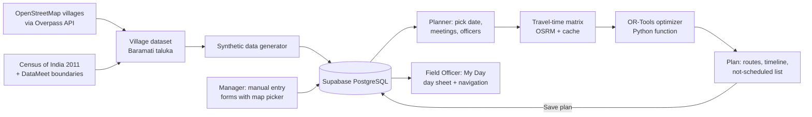
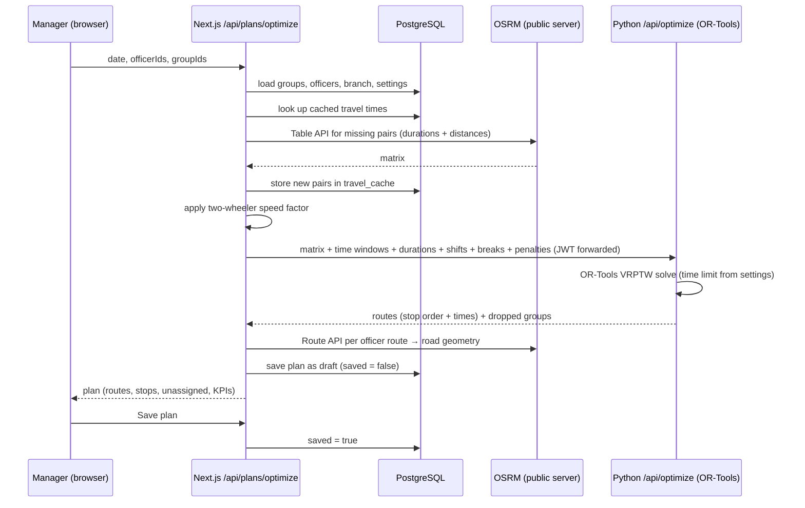

# MFI Route Optimizer — Project Flow

This document explains **how the product is used and how data moves through it**, from preparing village data to a field officer following their route. For how the system is built, see [architecture.md](architecture.md). For the handoff overview, see [handoff.md](handoff.md).

---

## 1. The problem in one paragraph

A microfinance (MFI) branch has a few **field officers** who ride two-wheelers to village **JLG (Joint Liability Group) meetings**. Every group meets on a fixed weekday inside a time window (e.g. Monday 09:00–10:30) and the meeting takes 30–45 minutes. Officers work fixed hours with a lunch break, and some groups are more urgent (overdue repayments, loan disbursement, new group). Each morning the **Manager** needs to decide *which officer visits which meetings, in what order, and when* — so that urgent meetings are covered and road travel is as short as possible. This is a **Vehicle Routing Problem with Time Windows (VRPTW)**, solved with Google OR-Tools.

---

## 2. Actors

| Actor | What they do |
|---|---|
| **Manager** | Everything: manages branches, officers, JLG groups and users, generates synthetic data, plans routes, saves plans, changes settings, resets passwords. |
| **Field Officer** | Logs in on a phone and sees only **My Day** — their own route for the day, with Google Maps navigation per stop. |
| **Seed / data scripts** (offline) | Prepare real village locations and synthetic JLG data before the app is used. |

---

## 3. End-to-end flow at a glance



---

## 4. Offline data preparation (done once, before using the app)

1. **Fetch villages** — a Python script queries the **Overpass API** for `place=village|hamlet` points inside Baramati taluka (Pune district) and saves name + latitude/longitude. OSM maps only ~20 named places here.
2. **Census list** — the **Census of India 2011** gives all 116 inhabited villages of Baramati with codes and population; each gets the centre of its boundary from **DataMeet's village maps**.
3. **Join** — OSM names are fuzzy-matched to census names; a matched village uses the OSM point (the settlement), the rest use the boundary centre. OSM places not in the census are kept with OSM data only.
4. **Compare travel times** — a Jupyter notebook (Folium maps) shows straight-line distance vs real road travel time from OSRM, to explain why road time matters.
5. **Generate synthetic data** — real JLG data is private, so a seeded generator places realistic JLG groups on the real villages (meeting day, window, duration, members, priority), plus the branch, 3 field officers and the demo user accounts.
6. **Load into Supabase** — the generator writes a `seed.sql` file that is run in the Supabase SQL editor (after the migration files).

> Same seed ⇒ same data every time, so the student and mentor always see identical demo data.

---

## 5. Authentication flow

```mermaid
sequenceDiagram
  participant U as Browser
  participant N as Next.js API (/api/auth/login)
  participant DB as PostgreSQL
  U->>N: email + password
  N->>DB: find user by email
  DB-->>N: user row (bcrypt hash, role, active)
  N->>N: bcrypt.compare(password, hash)
  alt wrong password or unknown email
    N-->>U: 401 "Incorrect email or password."
  else account deactivated
    N-->>U: 403 "This account has been deactivated."
  else OK
    N->>N: sign JWT (jose, HS256, 8 h) with userId + role
    N-->>U: Set-Cookie: session=<JWT>; HttpOnly; Secure; SameSite=Lax
  end
  U->>N: any later page / API request (cookie sent automatically)
  N->>N: proxy.ts verifies JWT, checks role for the route
  N->>DB: API routes re-check user.active
```

* After login: **Manager → `/` (Planner)**, **Field Officer → `/my-day`**.
* A Field Officer opening any manager page is redirected to `/my-day`; a Manager opening `/my-day` is redirected to `/`.
* **Forgot password:** there is no email flow. The login page says *"Forgot your password? Ask your manager to reset it."* — the Manager sets a new password from the Users page.
* **Logout** clears the cookie.

---

## 6. Manager flows

### 6.1 Set up data (Data section)

| Page | Flow |
|---|---|
| **JLG Groups** | Table with search, filters (priority, meeting day, source, status) and pagination. **Add / Edit** opens a side sheet: basic info → location (village, taluka, district, **click the map to place the pin** or drag it; picking a known village jumps the map) → schedule (day, frequency, window, duration) → priority + reason → assigned officer (or "Any officer") → active. Row actions: edit, duplicate, deactivate/reactivate. A *Data overview* card shows counts by source and a mini map. |
| **Officers** | Add/Edit: name, branch, route colour, **start location** (defaults to the branch, can be moved on the map), shift start/end, break start/duration, max meetings per day, active. |
| **Branches** | Add/Edit: name, taluka, district, address, map pin. |
| **Generate Synthetic Data** | Choose number of groups, radius from branch, % high/medium/low priority, meeting time range, duration range, random seed, and "replace existing synthetic data". **Preview** shows the points on a map; **Generate** saves them tagged `synthetic`. Manually entered data is never overwritten. |

Every record carries `source = synthetic | manual`.

### 6.2 Plan routes (Planner, `/`)



1. Pick the **date** → the left panel lists active groups whose `meeting_day` matches that weekday (Sunday has none).
2. Include/exclude meetings (search, priority filter, select all) and officers.
3. Press **Optimize Routes** → loading states *"Fetching travel times…"* then *"Optimizing routes…"*.
4. Review results:
   * **Map** — numbered coloured markers per officer, road-shaped route lines, grey hollow markers for groups that could not be scheduled, legend with per-officer show/hide, *Fit to routes*.
   * **Summary** — KPIs (meetings planned x/y, high-priority coverage, total distance, total travel time, average utilisation, solver status + solve time), per-officer cards, *Not scheduled* list with a reason.
   * **Timeline** — one row per officer from 08:00 to 18:00 showing travel, waiting, meetings, lunch break, and each meeting's allowed window.
5. **Save plan** → it appears in **Plans** history. Unsaved drafts are not listed.

**Why a group is not scheduled** (shown to the Manager):

| Reason | Meaning |
|---|---|
| `time_window_conflict` | No officer can reach it inside its meeting window. |
| `exceeds_working_hours` | Fitting it would push an officer past their shift. |
| `low_priority_dropped` | Skipped so higher-priority meetings fit. |
| `unreachable` | OSRM found no road route. |

### 6.3 Review plans (Plans, `/plans`)

* History table: date, officers, meetings planned/total, distance, status, created by/at.
* **Plan detail** `/plans/[id]`: KPIs, map, timeline, officer cards, not-scheduled list, **Export CSV**, **Print**.
* **Day sheet** `/plans/[id]/officer/[officerId]`: the same itinerary a field officer sees.

### 6.4 Manage users (Users, `/users`)

* Add user: name, email, role (Manager / Field Officer), branch, **linked officer** (required for Field Officers; an officer can be linked to only one user), initial password (with *Generate*).
* Edit role/branch/link, deactivate/reactivate, **Reset password** (generate + copy).
* **Self-protection:** the signed-in Manager cannot deactivate themselves or change their own role, so the app can never be left without a Manager.
* The **first Manager** is created by the seed script (nobody is logged in yet to create it).

### 6.5 Settings (`/settings`)

| Group | Settings | Used by |
|---|---|---|
| Working defaults | shift start/end, break start/duration, default meeting duration | pre-fills new officers and groups |
| Travel | **OSRM server URL** (default public server), **two-wheeler speed factor** (0.5–1.5×, multiplies OSRM car times), buffer minutes between meetings | travel-time engine |
| Optimization | penalty for skipping high/medium/low priority, allow late arrival (+15 min), solver time limit, balance workload | OR-Tools model |

---

## 7. Field Officer flow (My Day, `/my-day`)

1. Log in on a phone → lands on **My Day**.
2. Sees the latest **saved** plan that has meetings for them: start time, back-at-branch time, meetings done (x/y), total distance and travel time, a small route map.
3. Step list: *Start at branch → travel leg → [lunch break] → stop 1 (group, village, members, arrive, wait, meeting start–end, priority) → … → return to branch*.
4. Each stop has **Navigate** (opens Google Maps directions to the meeting location) and **Mark visited**.
5. **Print** gives a paper copy.
6. If no plan exists: *"No route planned yet."*

---

## 8. Page map

| Route | Who | Purpose |
|---|---|---|
| `/login` | everyone | sign in |
| `/` | Manager | Planner |
| `/plans`, `/plans/[id]`, `/plans/[id]/officer/[officerId]` | Manager | history, plan detail, day sheet |
| `/jlg-groups`, `/officers`, `/branches`, `/generate-data` | Manager | data management |
| `/users`, `/settings` | Manager | administration |
| `/my-day` | Field Officer | own route |
